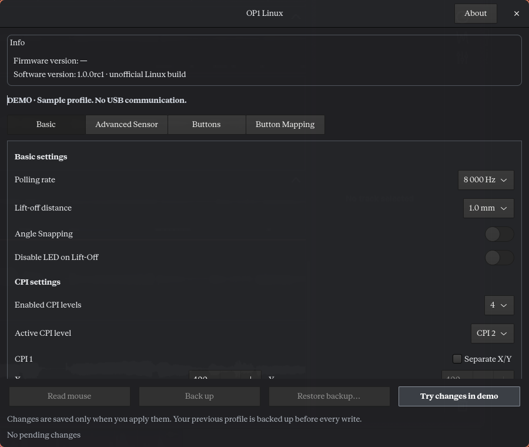

# OP1 Linux

An unofficial native Linux configurator for the **Endgame Gear OP1 8k v2** (`3367:1978`). English interface, GTK 4, no Wine or network required at runtime.

**1.0.0-rc.1 is a release candidate.** Configuration read-back is tested on firmware **1.07**. It is not a certification of sensor performance. See the [acceptance matrix](docs/ACCEPTANCE.md) for exact coverage and remaining checks.

[Download the release candidate](https://github.com/braga1k/op1-linux/releases/tag/v1.0.0-rc.1) · [CI](https://github.com/braga1k/op1-linux/actions)



## Install

Runtime dependencies: Python **3.11+**, PyGObject and GTK **4.8+**. This candidate has been exercised on Arch/Omarchy Linux x86_64; other distributions are not yet claimed as hardware-tested.

On Arch:

```sh
sudo pacman -S python python-gobject gtk4
```

On Debian/Ubuntu, the equivalent packages are `python3`, `python3-gi` and `gir1.2-gtk-4.0`.

Extract the release archive and install into your user prefix:

```sh
./install.sh
~/.local/bin/op1-linux
```

An application-menu entry is installed. A custom prefix is supported: `./install.sh --prefix /your/prefix`. No files are downloaded by the installer. The running app uses your normal user account.

For USB access, review `packaging/70-op1-linux.rules`, then install the rule once:

```sh
./install-access.sh
```

This requests administrator authentication, installs a `uaccess` rule limited to `3367:1978` and reloads it. Reconnect the mouse if necessary. The rule grants the active local session configuration access to this model; it does not open all HID devices. On systems without logind/uaccess, access must be configured by the administrator.

## Use

The current profile is read when the app opens. Edit a setting, review the pending changes and select **Apply to mouse**. A durable copy of the previous profile is saved before each write. The app then reads back and compares the full 1024-byte configuration payload.

- **Read mouse** reloads the device; pending edits require an explicit discard decision.
- **Back up** saves the device profile without discarding your edits.
- **Restore backup…** previews a backup, saves the current profile, restores supported fields and verifies the result. Unknown-field differences or new custom bindings are refused.
- **Ctrl+R** reads, **Ctrl+B** backs up, **Ctrl+Enter** applies, and **Ctrl+1–4** changes tabs. Normal Tab/Shift+Tab navigation is available.

Profiles are kept in `$XDG_STATE_HOME/op1-linux/backups`, falling back to `~/.local/state/op1-linux/backups`. They survive upgrades and removal. Legacy preview backups without a checksum can be reviewed and restored only when their changes are understood. The old preview's `data/backups/` directory is kept in place; browse to it through Restore backup… if needed.

After an uncertain write, reconnect/read the mouse before doing anything else. An error after sending does not mean nothing changed; the backup path is included in the error.

## Settings

- Polling: 125, 250, 500, 1000, 2000, 4000 and 8000 Hz.
- One to four CPI levels, active level and separate X/Y values. CPI is rounded in steps of 10 up to 10,000, then 50 up to 30,000.
- Lift-off distance, angle snapping, Motion Sync, motion jitter filter, maximum sensor FPS, LED on lift-off and sensor angle tuning.
- Firmware 1.07 smoothing and CPI downshift tuning.
- Slamclick, five multiclick filters, and GX Safe/Speed for the two main buttons.
- Seven button/wheel mappings with mouse, CPI-cycle and media actions. At least one physical button must retain Left click. Existing custom/keyboard bindings are preserved.

The four tabs follow the vendor tool's organization, with a dark palette. Narrow tiled windows use stacked controls and compact tab navigation; content scrolls while the action buttons remain accessible. Layouts were checked at 400, 520 and 900 px, plus 2× scale; 400 logical px is the supported minimum width. No window-manager rules are required.

## Compatibility and limits

Writing requires firmware **1.07**. Unknown firmware can be read and backed up if its profile is structurally compatible. Glass Mode is preserved; changing polling or lift-off while it is enabled is unsupported.

This candidate does not add firmware updates, macro/keyboard-action authoring, fixed-CPI action authoring, factory reset or live hardware-button notifications. A read refreshes hardware changes; stale profiles are refused before writing. Do not run two configurators simultaneously; the advisory lock coordinates instances of this app only.

Hardware configuration and persistence are separate from physical effects: stored values do not establish real CPI accuracy, effective USB report rate, sensor filtering, lift-off distance or click latency. Those measurements remain explicitly unverified.

## Development and tests

```sh
./run.sh --demo
python3 -m unittest discover -s tests -v
OP1_TEST_GUI=1 python3 -m unittest discover -s tests -p test_gui.py -v
./run.sh --demo --smoke
python3 scripts/build-release.py
```

GTK integration requires a display (or Xvfb/Broadway). Hardware tests are opt-in and never run in CI. `scripts/validate-hardware.py --run` temporarily changes supported settings and restores the original profile after each case. `scripts/validate-reconnect.py --run` requires physically disconnecting/reconnecting the mouse and restores the original profile afterwards. Keep a keyboard available for recovery; inspect the scripts first.

## Remove

For the default installation:

```sh
python3 ~/.local/lib/op1-linux/packaging/install.py --uninstall
```

Use the same `--prefix` if you installed elsewhere. Backups are kept. If you no longer need the access rule, an administrator can remove `/etc/udev/rules.d/70-op1-linux.rules` and reload udev; that is separate from removing the app.

## Evidence and attribution

[Protocol evidence](PROTOCOLO.md), [audit](docs/AUDIT.md), [acceptance matrix](docs/ACCEPTANCE.md) and [release notes](CHANGELOG.md).

Protocol analysis used [REA](https://github.com/morluto/rea) and [Ghidra](https://github.com/NationalSecurityAgency/ghidra), then differential tests against the original 1.07 program. Additional reference: [UnofficialEGGWebConfig](https://github.com/qsxcv/UnofficialEGGWebConfig), by qsxcv and contributors. See [NOTICE](NOTICE) and [AGPL-3.0 license](LICENSE).

Not affiliated with or endorsed by Endgame Gear. Vendor executables, firmware and development engines are not distributed with the application.
